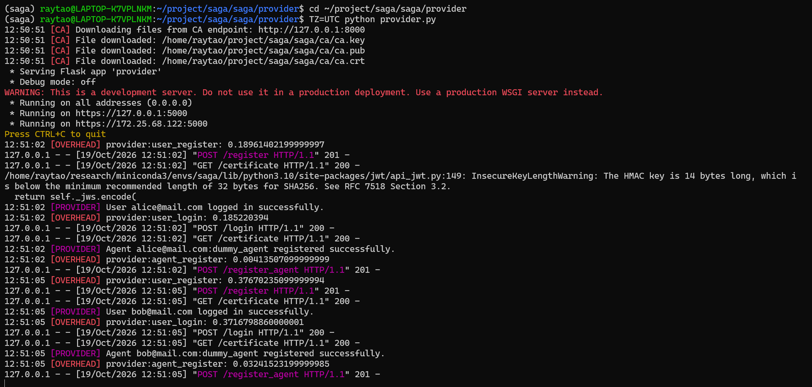
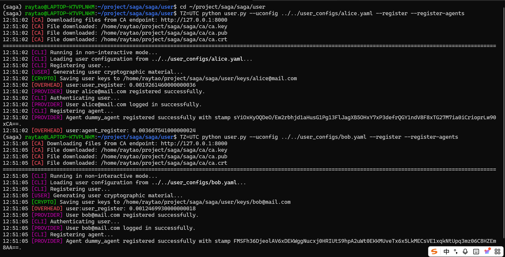
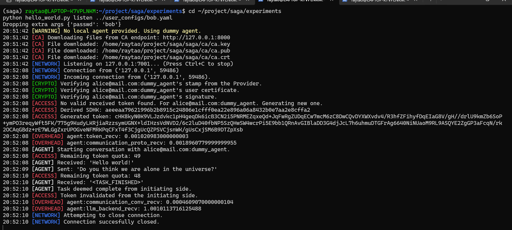
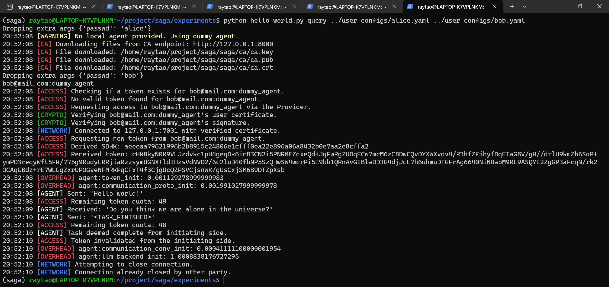
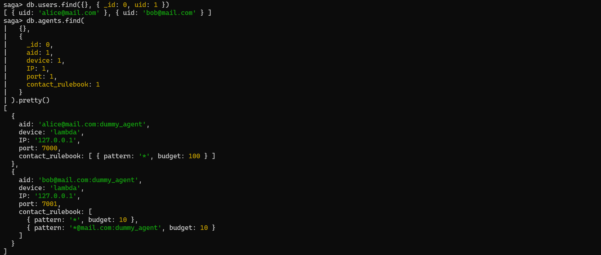

------

## 论文基本信息

题目：SAGA: A Security Architecture for Governing AI Agentic Systems [PDF](https://www.ndss-symposium.org/wp-content/uploads/2026-s869-paper.pdf)  

工作完成时间：初版提交（v1）：**2025年4月27日**；修订版提交（v2）：**2025年8月29日**

作者：Georgios Syros（博士生）, Anshuman Suri（博士后研究员）, Jacob Ginesin（参与时为本科生，现在卡内基梅隆大学攻读博士）, Cristina Nita-Rotaru （NDS2 实验室联合主任）, Alina Oprea（NDS2 实验室联合主任）

机构：Network and Distributed Systems Security [[nds2](http://nds2.ccs.neu.edu/)]，Northeastern University

开源代码：https://github.com/gsiros/saga

NDSS会议视频：https://www.youtube.com/watch?v=NZvfPHAciyE

NDSS会议PPT：https://www.ndss-symposium.org/wp-content/uploads/s0869-syros-slides.pdf

------

## 代码复现 SAGA

### 一、环境配置

基本环境：一台 Windows11 的个人笔记本，配置了 WSL2 环境，使用 Miniconda 管理 Python 环境，并用 Pycharm运行代码。在Windows 下安装了 Docker Desktop。

#### 1 下载源码

```bash
mkdir -p ~/project
cd ~/project
git clone https://github.com/gsiros/saga.git
cd saga
ls
```

#### 2 配置 Python 环境

使用 conda 创建 python = 3.10.16：

```bash
conda create -n saga python=3.10.16 pip -y
conda activate saga
```

**根据项目`requirements.txt` 配置需要的库环境：**

```bash
python -m pip install simple-parsing

python -m pip install \
  -r <(sed '\|github.com/lebrice/SimpleParsing|d' requirements.txt) \
  "smolagents==1.12.0" "PyYAML==6.0.2"

python -m pip install -e .
```

测试 python 环境是否可以：

```bash
python -c "from simple_parsing.helpers import Serializable; import saga.config; print('依赖导入成功')"
```

#### 3 配置数据库

使用 Docker 为 SAGA 项目创建一个独立的 MongoDB 数据库，用于持久化存储项目运行过程中产生的数据。主要用于保存 Provider 注册信息（服务提供者的配置、注册记录等）。邮件数据（工具读取或处理的邮件信息）。日历数据（日程、事件等）。文档数据（工具管理的文档信息）。

在 wsl 中检查 docker 版本，正常情况下会同时显示 `Client` 和 `Server` 信息：

```bash
docker version
```

**创建 SAGA 专用 Mongo DB。**

参数解析：容器命名为 `saga-mongo`；Docker 重启后自动启动，除非手动停止；将MongoDB端口映射到宿主机本地；使用 Docker 数据卷持久化数据库数据（即使删除 MongoDB 容器，数据卷通常仍会保留，避免数据库数据丢失）；使用MongoDB 7.0 官方镜像：

```bash
docker run -d \
  --name saga-mongo \
  --restart unless-stopped \
  -p 127.0.0.1:27017:27017 \
  -v saga-mongo-data:/data/db \
  mongo:7.0
```

检查数据库：

```bash
docker ps --filter name=saga-mongo
docker exec saga-mongo mongosh --quiet --eval 'db.adminCommand({ping: 1})'

# 正常输出
{ "ok": 1 }
```

**以后已有容器时，使用以下命令进行启动或停止：**

```bash
# 启动：
docker start saga-mongo
# 停止：
docker stop saga-mongo
```

从 python 检查连接：

```bash
python -c "from pymongo import MongoClient; c=MongoClient('mongodb://localhost:27017/', serverSelectionTimeoutMS=5000); print(c.admin.command('ping'))"

# {'ok': 1.0}
```

再确认项目读到了本地配置：（`config_local.yaml`用于本地单机复现，`config.yaml`则是为实际配置）

```bash
# 备份原始配置：
cd ~/project/saga
cp config.yaml config.yaml.bak
#使用官方本地配置覆盖：
cp config_local.yaml config.yaml
# 验证配置：
python -c "import saga.config as c; print(c.CA_CONFIG['endpoint']); print(c.PROVIDER_CONFIG['endpoint']); print(c.MONGO_URI_FOR_TOOLS)"
# 输出
CA: http://127.0.0.1:8000
Provider: https://127.0.0.1:5000
Tools DB: mongodb://127.0.0.1:27017/saga_tools
```

------

### 二、试运行

确保各方环境准备完毕。进入项目目录，激活 `saga` conda 环境，确认 `config.yaml` 已采用 `config_local.yaml` 的本地配置；启动 Docker：`docker start saga-mongo`，确认 WSL 中的 Python 能连接 MongoDB。

然后启动四个终端 `A`、`B`、`C`、`D`，`E`：**A 负责 CA 文件服务**，端口 `8000`；**B 负责 Provider**，端口 `5000`；**C 负责注册**；**D 负责 Bob**，端口 `7001`；**E 负责 Alice**，发起通信。

#### 1 终端 A：生成 CA 材料并启动文件服务

**保持这个终端运行。** 首次运行生成证书即可，后续启动一般不需要重新生成。 在项目的实际部署过程中，CA 配置指定了其文件服务端点 http://129.10.186.246:8000，并设置了证书主体信息：国家 US、州 MA、城市 Boston、组织 ca。

```bash
wsl
conda activate saga
cd ~/project/saga

# 读取 config.yaml 中的 CA 配置，在 saga/ca/ 下生成：ca.key(CA私钥)	ca.pub(CA公钥)	ca.crt(CA自签名证书)
mkdir -p ~/project/saga-ca-server
TZ=UTC python generate_credentials.py ca /home/raytao/project/saga-ca-server/

# 把当前目录通过 HTTP 提供出来，地址是 http://127.0.0.1:8000，可以访问这个下载 CA证书
python -m http.server 8000 --bind 127.0.0.1 \
  --directory /home/raytao/project/saga-ca-server

# 输出
Serving HTTP on 127.0.0.1 port 8000 (http://127.0.0.1:8000/) ...
```


------

#### 2 终端 B：启动 Provider

**保持这个终端运行。** 注意必须在 `saga/provider` 目录启动，因为程序用当前目录保存 Provider 证书。

首先 Provider 从 CA 端点 `http://127.0.0.1:8000` 拉取 `ca.key`、`ca.pub`、`ca.crt` 三个文件。Provider 是一个 Flask 应用，监听 `0.0.0.0:5000`（所有网卡），所以本机 `127.0.0.1:5000`  都能访问。

```bash
wsl
conda activate saga
cd ~/project/saga/saga/provider

# 一定要加 TZ=UTC，确保证书时间
TZ=UTC python provider.py

# 输出
Running on https://127.0.0.1:5000
```



------

#### 3 终端 C：注册 Alice、Bob 及其 Agent

若已经注册过，再次注册会失败。可以运行以下重置：

```python
python - <<'PY'
from pymongo import MongoClient

with MongoClient("mongodb://localhost:27017") as client:
    db = client["saga"]
    agents = db.agents.delete_many({})
    users = db.users.delete_many({})
    print(f"删除用户 {users.deleted_count} 个，Agent {agents.deleted_count} 个")
PY
```

```bash
wsl
conda activate saga
cd ~/project/saga/saga/user

# 注册
TZ=UTC python user.py --uconfig ../../user_configs/alice.yaml --register --register-agents
TZ=UTC python user.py --uconfig ../../user_configs/bob.yaml --register --register-agents

# 输出
saga/user/alice@mail.com:dummy_agent/agent.json
saga/user/bob@mail.com:dummy_agent/agent.json
```



------

#### 4  终端 D：让 Bob 等待连接

注册完成后，在同一个终端执行，Bob 将监听 `7001` 端口。**保持运行**：

```bash
cd ~/project/saga/experiments
python hello_world.py listen ../user_configs/bob.yaml
```



------

#### 5 终端 E：让 Alice 发起通信

这条命令表示：**Alice 发起请求，联系 Bob**。成功时，两侧会出现连接、令牌和消息交互日志。DummyAgent 会随机回复简单句子，直到结束；不一定原样回复 `Hello world!`。

```bash
conda activate saga
cd ~/project/saga/experiments

python hello_world.py query ../user_configs/alice.yaml ../user_configs/bob.yaml
```



------

#### 6 数据库操作

项目的注册信息保存在 MongoDB 的 **`saga` 数据库**中，`users用户注册表`,`agents 智能体注册表`。

```bash
# 连接数据库
docker ps
docker exec -it saga-mongo mongosh saga
# 查看注册数量和用户列表
show collections
db.users.countDocuments({})	# 2
db.agents.countDocuments({}) # 2
db.users.find({}, { _id: 0, uid: 1 }) # [ { uid: 'alice@mail.com' }, { uid: 'bob@mail.com' } ]
# 查看所有 Agent 的注册情况
db.agents.find(
  {},
  {
    _id: 0,
    aid: 1,
    device: 1,
    IP: 1,
    port: 1,
    contact_rulebook: 1
  }
).pretty()
# 查看所有 Agent 的剩余一次性密钥数量：
db.agents.aggregate([
  {
    $project: {
      _id: 0,
      aid: 1,
      remaining_otks: {
        $size: { $ifNull: ["$one_time_keys", []] }
      },
      counter: 1
    }
  }
])
```




------

### 三、项目代码详解

**用户向 Provider 注册自己和 Agent；发起方通过 Provider 获取接收方信息及一次性密钥；两个 Agent 建立令牌与安全连接，随后直接通信。** Provider 不转发后续所有对话。以下是项目图：


#### 1 项目目录略看

```markdown
saga/
├── setup.py                         # Python 包安装配置
├── requirements.txt                 # Python 依赖清单
├── saga.yml                         # Conda 环境配置
├── config.yaml                      # 实际读取的全局配置
├── config_local.yaml                # 本地部署配置样例
├── generate_credentials.py          # 生成证书及密钥材料
│
├── saga/                            # SAGA 协议与通信框架
│   ├── __init__.py
│   ├── config.py                    # 配置加载与配置对象
│   ├── agent.py                     # Agent 通信与会话管理
│   ├── local_agent.py               # 任务执行接口与模拟 Agent
│   ├── logger.py                    # 日志辅助类
│   ├── ca/
│   │   └── CA.py                    # 证书材料管理与证书操作
│   ├── provider/
│   │   └── provider.py              # 注册与访问授权服务
│   ├── user/
│   │   ├── __init__.py
│   │   └── user.py                  # 用户命令行客户端
│   └── common/
│       ├── contact_policy.py        # 联系规则检查与匹配
│       ├── crypto.py                # 密钥、签名、证书和令牌工具
│       ├── logger.py                # 主要使用的日志工具
│       └── overhead.py              # 运行耗时记录
│
├── agent_backend/                   # LLM 任务执行层
│   ├── __init__.py
│   ├── config.py                    # LLM Agent 配置对象
│   ├── base.py                      # 模型与工具的统一封装
│   ├── custom_prompts/
│   │   ├── CodeAgent.yaml           # 默认提示词模板
│   │   └── finalized/
│   │       └── CodeAgent_calendar.yaml
│   └── tools/
│       ├── __init__.py
│       ├── base.py                  # 业务工具公共接口
│       ├── email.py                 # 邮件工具
│       ├── calendar.py              # 日历工具
│       └── documents.py             # 文档工具
│
├── experiments/                     # 示例与任务入口
│   ├── hello_world.py               # 无 LLM 的通信示例
│   ├── schedule_meeting.py          # 协商会议任务
│   ├── expense_report.py            # 汇总报销任务
│   ├── create_blogpost.py           # 协作写作任务
│   ├── seed_tool_data.py            # 导入业务示例数据
│   ├── test.py                      # 工具与本地 Agent 调试脚本
│   └── data/
│       ├── emma/
│       │   ├── email.jsonl
│       │   ├── calendar.jsonl
│       │   └── documents.jsonl
│       └── raj/
│           ├── email.jsonl
│           ├── calendar.jsonl
│           └── documents.jsonl
│
└── user_configs/                    # 用户和 Agent 配置
    ├── alice.yaml
    ├── bob.yaml
    ├── candice.yaml
    ├── emma.yaml
    ├── mallory.yaml
    └── raj.yaml
```

------

#### 2 配置文件

**1）**`config.yaml` 与 `config_local.yaml`:

`config.yaml` 是项目运行时实际读取的全局配置文件，用于指定 CA、Provider 的服务地址、工具数据库地址以及用户和 Agent 的默认证书信息；`config_local.yaml` 则是供**本机部署参考的配置样例**，将相关服务地址设为 `127.0.0.1`。程序不会自动切换到 `config_local.yaml`，因此本地运行时，需要将其内容复制到 `config.yaml`，或参照它修改对应配置。


**2）**`alice.yaml`、`bob.yaml`、`candice.yaml`、`emma.yaml`、`mallory.yaml`、`raj.yaml`

这些文件是**不同示例用户的配置文件**，用于描述用户姓名、邮箱、登录密码及其拥有的 Agent，并为每个 Agent 指定名称、运行地址、端口、**联系规则、一次性密钥数量**，以及**模型和工具配置**。其中：

1. `alice.yaml`、`bob.yaml` 和 `candice.yaml` 主要配置不使用 LLM 的模拟 Agent，**供基础通信或协议测试使用**；智能体名称均为 dummy_agent，其联系策略设置不同。
2. `emma.yaml` 和 `raj.yaml` 配置日历、邮件和写作 Agent，用于三类协作任务；这两个用户配置详细的`local_agent_config`字段。`emma.yaml`拥有三个智能体，第一个`calendar_agent`使用模型`gpt-4.1-mini-2025-04-14`；第二个`email_agent`智能体，使用模型`gpt-4.1-2025-04-14`；第三个`writing_agent`使用模型`gpt-4.1-2025-04-14`。`raj.yaml` 同样如此配置。【论文中提到的本地部署的`Qwen-2.5 72B`模型可以自己同样配置。我要复现这个地方的话，没有`gpt`的模型`api`，看是否能够用`deepseek`的api进行替代。（估计要修改源码，不然充`gpt`的`api`可能比较贵）】
3. `mallory.yaml` 则应该是提供**攻击**实验中的用户与 Agent 配置。不过这里源码依旧给的是`dummy_agent`。


**3）**`generate_credentials.py`

`generate_credentials.py` 用于**生成 CA 的密钥对和自签名证书，并保存到指定目录**。运行时，通过命令行参数 `ca` 选择 `config.yaml` 中对应的证书配置，再由 `main(config, file_path)` 完成生成和保存，输出 `.key` 私钥文件、`.pub` 公钥文件和 `.crt` 证书文件。

------

#### 3 saga

**1）**`config.py`

`saga/config.py` 负责加载全局配置，并定义用户和 Agent 的配置结构。在 `saga/ca/CA.py` 和`generate_credentials.py`中被调用。

```python
CA_CONFIG = None
# Auto-load on first import
if not CA_CONFIG:
    populate_config()
```

**模块导入时**会调用 `populate_config()`，读取根目录的 `config.yaml`，检查必要配置并保存 CA、Provider、工具数据库及默认证书信息，同时定义相关工作目录和令牌通信配额。

-  `EndPointConfig` 描述 Agent 的 IP、端口和设备名，并检查端口范围，包括 **ip、port、device_name**；
- `AgentConfig` 描述 Agent 的基本信息、联系规则和模型配置，包括 **name**、description、**local_agent_config**: LocalAgentConfig、**endpoint**: EndPointConfig、**contact_rulebook**: Optional[List[str]]、**num_one_time_keys**: Optional[int] ;
- `UserConfig` 描述用户及其 Agent 列表，包括 **name**、**email**、**agents:** List[AgentConfig]；

`get_index_of_agent()` 则根据名称查找指定 Agent 在配置列表中的位置。


**2）**`agent.py`

`saga/agent.py` 是 **Agent 通信与会话管理的核心模块**，负责加载身份材料、向 Provider 获取目标 Agent 的访问资料、管理访问令牌，以及建立连接和收发消息。

文件中的 `get_agent_material()` 读取 Agent 工作目录下的 `agent.json`(`agent.json`内容如下图)，`serialize()` 和 `deserialize()` 函数负责传输数据的格式转换；


文件还定义了一个核心类 `Agent`， 是==具体智能体外层的安全通信封装==：

1. `__init__()` 加载身份、证书、密钥、联系规则和 Token 缓存，并设置任务执行后端 `LocalAgent`，**未提供时使用仅返回随机测试回复的 `DummyAgent`；**
2. `get_provider_cert()` 获取 Provider 证书，`access()` 用于请求目标智能体资料；
3. `generate_token()` 等函数管理 Token 的生成、保存、有效期、通信额度及持有人绑定，具体为：
   1. `generate_token()`：签发方生成 Token，设置一小时有效期、通信额度和持有人 PAC，再使用共享密钥加密
   2. `store_received_token()`：持有方收到并解密 Token 后，保存 Token 及其状态，建立目标 AID 与 Token 的映射
   3. `received_token_is_valid()`：持有方在每轮发送消息前，本地检查 Token 是否存在、是否过期、额度是否耗尽。
   4. `token_is_valid()`：签发方收到消息后，检查 Token 是否由自己签发、是否过期、额度是否耗尽，以及持有人 PAC 是否匹配。
   5. `initiate_conversation()` 和 `receive_conversation()` 中的相关逻辑：双方分别扣减本地记录的额度，在正常任务结束时删除 Token。第 3～5 步随对话循环执行。
   6. `retrieve_valid_token()`：后续再次调用 `connect()` 联系同一目标时，查找已有 Token，并调用 `received_token_is_valid()` 检查；有效则复用，失效则清理并重新申请。
4. 主动通信时，`connect()` 获取并验证智能体目标身份，建立双向 TLS 连接，再复用已有 Token 或通过一次性密钥协商申请新 Token；
5. 接收通信时，`listen()` 监听连接并交给 `handle_i_agent_connection()`，后者检查联系规则、证书和签名，然后验证或签发 Token；
6. 连接通过验证后，`initiate_conversation()` 和 `receive_conversation()` 分别控制双方的多轮收发，每轮将收到的内容交给 `LocalAgent.run()` 处理并生成下一条消息，直到任务结束标记出现、Token 失效或达到次数限制；
7. 底层 `send()`、`recv()` 则通过“长度前缀＋JSON”传输消息。

因此，**`Agent` 负责安全连接和对话流程，`LocalAgent` 负责具体任务的思考与执行。**


**3）**`local_agent.py`

`saga/local_agent.py` 定义具体任务执行后端的统一接口。定义了一个主要使用的抽象类 `LocalAgent` 和一个测试用的`DummyAgent`，使 SAGA 通信框架能够接入不同的 Agent 实现。

其中 `LocalAgent` 类要求子类实现`run(query,initiating_agent,agent_instance=None)`，接收对方消息、当前是否为对话发起方，以及用于延续上下文的后端实例，并返回“后端实例和回复文本”；这样，SAGA 的 `Agent` 就可以通过统一方式调用不同模型或智能体框架，而不必关心其内部实现。

测试用的 `DummyAgent`，它将<TASK_FINISHED>作为任务结束标记，每次调用通常等待一秒后随机返回一句预设回复，用于测试通信与对话流程，不执行真实业务任务。


**4）**`logger.py`

`logger.py` 定义了一个轻量级控制台日志工具 `Logger`，所有方法都是静态方法，无需创建实例即可使用；它提供三种输出方式：

- `log(tag, message)` 输出普通日志，通**过标签的 MD5 哈希固定选择**七种颜色之一，**只给 `[TAG]` 着色**；
- `warn(message)` 输出黄色的警告日志，`error(message)` 输出红色的错误日志，后两者会给**标签和消息一起着色**。

所有日志都包含 `HH:MM:SS` 格式的进程本地时间；底层均使用 `print()` 输出到标准输出，不会自动保存文件，也没有日志级别过滤或异常堆栈处理。


**5）**`ca/`、`provider/`、` user/`

- **`ca/`**：**负责 SAGA 的证书信任基础，核心文件是 `CA.py`。**

其中 `CA` 类从配置的 CA 文件服务下载密钥和证书，再加载到本地；`sign()` 使用 CA 私钥为用户、Provider 或 Agent 的公钥签发证书，`verify()` 使用 CA 公钥验证证书签名，`get_SAGA_CA()` 则根据项目配置创建 CA 对象。需要注意，当前实现是下载 CA 私钥后在本地签发证书，因此，当前实现中能下载 `ca.key` 的程序，也就具备了以该 CA 身份签发证书的能力。


- **`provider/`**：**负责用户和 Agent 的集中注册、身份资料管理与访问协调，核心文件是 `provider.py`。**

`Provider` **是 SAGA 的身份注册与访问协调的一个 web server**：它以 MongoDB 保存用户和 Agent 资料，通过 HTTPS 接口提供用户认证、Agent 注册、身份背书和访问申请处理，帮助 Agent 在权限允许的前提下获取彼此的连接信息，随后由 Agent 直接通信。

`provider.py` 的执行从文件末尾的 **main** 入口开始：它从配置中读取服务端口，创建 `Provider` 对象，进入 `__init__()` 初始化 Flask、MongoDB 用户与 Agent 集合、密码哈希工具 Bcrypt、JWT 管理器及 CA 对象；如果工作目录中的 Provider 密钥或证书不齐全，就生成密钥并通过 CA 对象签发证书，否则加载已有凭据，随后调用 `_register_routes()` 注册所有接口，最后由 `run()` 加载服务端证书和受信任的 CA，要求客户端提供有效证书，以双向 TLS 启动 HTTPS 服务。按业务使用顺序：

1. `index()` 对应 `GET /`，只返回简单欢迎页面；
2. `certificate()` 对应 `GET /certificate`，返回 Base64 编码的 Provider 证书，供客户端获取其公钥并验证身份；（**获取Provider证书的接口**）
3. `register()` 对应 `POST /register`，接收用户 UID、密码和用户证书，检查用户是否重复、验证证书签名，将密码转换为哈希后连同证书保存到数据库；（**用户注册接口**）
4. `login()` 对应 `POST /login`，检查用户和密码，成功后生成 JWT，将其及数据库中设置的一天后到期时间保存到用户记录，并把 JWT 返回给客户端；（**用户登录接口**）
5. `register_agent()` 对应 `POST /register_agent`，接收用户 UID、JWT 和 Agent 注册材料，检查登录凭据、AID 格式与唯一性、IP 和端口是否被占用，验证 Agent 证书、用户对身份材料及一次性公钥的签名，并检查联系规则，随后保存 Agent 资料，用 Provider 私钥为 Agent 名片生成 `stamp` 并返回；（**用户注册智能体的接口**）
6. `access()` 对应 `POST /access`，在发起方想联系目标 Agent 时执行，通过客户端证书与数据库记录核实发起方身份，检查目标是否存在及其联系规则是否允许访问、访问预算是否充足，再通过数据库原子更新扣减该发起方的访问预算并取出目标的一组一次性公钥及签名，最后返回目标的地址、证书、PAC、用户证书等连接材料，供双方直接建立安全连接。（**处理智能体间联系的接口**）


- **`user/`**：**负责用户侧的注册、登录和 Agent 身份准备，核心文件是 `user.py`，支持交互式操作以及读取配置文件批量执行。**

按执行逻辑，模块加载时先通过 `get_SAGA_CA()` 初始化 CA 对象，并建立保存当前用户、密钥、Agent 资料和登录 Token 的内存状态；

`main`入口解析命令行参数，支持通过 `--interactive` 显示菜单逐项操作，或通过 `--uconfig` 读取 YAML 配置，结合 `--register`、`--login`、`--register-agents` 自动执行。例如：

```bash
 python user.py --uconfig ../../user_configs/alice.yaml --register --register-agents
```

首次使用时，`register(email, password)` 生成用户的 Ed25519 身份密钥，通过本地 CA 对象签发用户证书，将密钥和证书保存到 `user/keys/`，再向 Provider 的 `/register` 提交 UID、密码和用户证书，成功后调用 `get_provider_cert(email)`，使用用户证书进行双向 TLS 请求，从 `/certificate` 获取 Provider 证书并验证；随后 `login(email, password)` 向 `/login` 提交账号密码，成功后保存返回的 JWT，加载用户本地密钥，并获取、验证 Provider 证书，准备后续 Agent 注册所需的签名能力和 Provider 公钥。

接着，`register_agent()` 获取 Agent 名称、设备、IP、端口、一次性密钥数量及联系规则，用“**用户 UID:Agent 名称**”构造 AID，生成 Agent 的 Ed25519 身份密钥和证书、X25519 长期访问控制密钥及一批一次性密钥，再用用户私钥对绑定身份、网络信息和相关公钥的数据块以及每个一次性公钥签名，将公开材料、联系规则、UID 和 JWT 提交到 `/register_agent`；

注册成功后，接收 Provider 返回的名片签名 `stamp`，补充用户证书、Agent 私钥、访问控制私钥和一次性私钥，交给 `spawn_agent(application)` 创建以 AID 命名的目录并写入 `agent.json`，供后续 `Agent` 实例加载。

**其中 `spawn_agent()` 只保存运行材料，不会启动 Agent；非交互模式的 `--register-agents` 会在注册每个 Agent 前自动调用 `login()`。**


**6）**`common/`

`saga/common/` 存放注册与通信模块共用的辅助功能：

1. `contact_policy.py` 负责检查 Agent 标识和联系规则，并匹配访问预算；
2. `crypto.py` 提供了 Ed25519 密钥生成、数字签名和签名验证，用于证明身份及检查数据是否被篡改；X25519 密钥生成与转换，用于准备密钥交换所需的长期密钥和一次性密钥；X.509 证书生成、CA 签发及证书签名验证，用于建立身份信任关系；AES-GCM 加密与解密，用于保护访问控制 Token 的机密性和完整性；同时提供密钥、证书的保存与加载，以及原始字节、PEM、DER 和 Base64 之间的编码转换，并引入 HKDF 和 SHA-256，供通信协议从密钥交换结果中派生共享密钥；
3. `logger.py` 统一输出带时间和模块标签的日志；
4. **`overhead.py` 通过 `Monitor` 类记录各项操作的开始、结束和累计耗时，为运行状态观察和性能统计提供支持。**

**（原始项目中并未调用这个，后续可能需要我们自己写代码来复现完整的开销测试。）**

------

#### 4 agent_backend

**1）**`config.py `

`agent_backend/config.py` 定义了具体智能体后端的配置类 `LocalAgentConfig`，通过数据类集中描述使用哪个模型、如何连接模型以及允许调用哪些工具：

`model` 指定模型名称，`tools` 指定工具列表，`model_type` 指定模型接入类型，`api_base` 指定模型服务地址，`base_agent_type` 指定后端智能体类型，`specific_agent_instruction` 提供额外任务指令，`additional_authorized_imports` 指定智能体生成代码时允许额外导入的模块。


该类继承 `Serializable`，便于从 YAML 等配置文件加载和保存配置；`__post_init__()` 在对象创建后进行校验，当前会检查使用 `OpenAIServerModel` 时是否提供 `api_base`。它本身不加载模型或执行任务，而是为后续创建具体后端提供配置。


**2）**`base.py`

`agent_backend/base.py` **负责将具体的大模型和工具封装成符合 SAGA `LocalAgent` 接口的任务执行后端：**

入口函数 `get_agent()` 根据配置选择后端，当前只实现了 `CodeAgentWrapper`；它继承 `AgentWrapper`，初始化时通过 `_collect_tools_for_use()` 按配置收集邮件、日历、文档、报销及用户信息工具，通过 `_initialize_base_model()` 接入本地 Transformers 模型、Hugging Face API 或 OpenAI 兼容服务，再由 `_set_custom_prompt()` 加载提示词模板。

开始新对话时，`_initialize_agent()` 根据发起方或接收方角色，填入日期、任务、额外指令和结束标记，并调用子类的 `_create_local_agent_object()` 创建 smolagents 的 `CodeAgent`，配置模型、工具和允许导入的模块；

随后 `run()` 将收到的消息交给它执行，同一对话通过 `agent_instance` 和 `reset=False` 延续上下文，新对话则创建独立实例，最后返回后端实例与回复，并将特定完成回复转换为 `<TASK_FINISHED>`。因此，这个文件是 **SAGA 安全通信层与大模型任务执行层之间的适配桥梁**。


**3）**`custom_prompts/`

`agent_backend/custom_prompts/` 用于存放智能体的提示词模板，**当前 `base.py` 加载的是 `CodeAgent.yaml`**，其中 `system_prompt` 定义模型如何分步生成 Python 代码、调用工具、读取执行结果，并通过 `final_answer` 向对方 Agent 回复，同时规定不能编造信息、不能把对方误认为自己的用户，以及完成任务后应只发送结束标记；

`initiating_agent` 和 `receiving_agent` 分别描述对话发起方与接收方的角色。创建后端时，`base.py` 会填入当前日期、额外任务指令、任务内容和 `<TASK_FINISHED>` 等占位符：接收方角色说明插入系统提示词，发起方角色说明则作为任务记录加入会话历史。因此，这个目录主要控制 **模型如何理解角色、使用工具和组织对话**，身份验证、访问权限及 Token 检查仍由 SAGA 的程序逻辑负责。


**4）**`tools/`

`agent_backend/tools/` 提供 LLM Agent 执行任务所需的业务工具，数据由 MongoDB 保存。其中，`base.py` 定义公共基类 `BaseTool`，提供数据库集合访问、数据清理和联系人信息提取等功能；

`email.py` 提供邮件导入、收发和检索功能；

`calendar.py` 提供日程导入、日程查询、空闲时间查询及会议创建功能；

`documents.py` 提供文档导入、检索和创建功能。

上述工具由 `agent_backend/base.py` 封装后提供给模型调用，`__init__.py` 则用于标识 Python 包。

------

#### 5 experiments

**1）**`hello_world.py`

`experiments/hello_world.py` 是不依赖 LLM 的双 Agent 通信示例，用于演示 SAGA 的基本连接与对话流程。其 `main()` 函数读取用户配置中的 `dummy_agent`，加载对应的 `agent.json` 身份材料并创建 `Agent` 实例：在 `listen` 模式下等待其他 Agent 连接，在 `query` 模式下读取目标用户配置，主动连接对方并发送 `"Hello world!"`。由于没有传入具体任务执行对象，对话回复由 `DummyAgent` 生成。


**2）**`schedule_meeting.py`、`expense_report.py `、`create_blogpost.py`

`experiments/` 中的这三个文件分别是论文三类协作任务的运行入口：`schedule_meeting.py` 让两个日历 Agent 查询空闲时间、协商并创建会议，随后检查双方日程是否一致、是否冲突及会议时长是否符合要求；`expense_report.py` 让两个邮件 Agent 收集费用信息、汇总金额并向 HR 提交报销邮件，随后检查邮件参与者和金额；`create_blogpost.py` 让两个写作 Agent 参考已有文档协作撰写文章，随后检查是否保存了符合预期标题的文档。三个文件均通过 `main()` 加载配置并创建 Agent，支持 `listen` 接收任务和 `query` 主动发起任务两种模式。


**3）**`seed_tool_data.py`

`experiments/seed_tool_data.py` 用于初始化协作任务所需的邮件、日历和文档数据。其中，`read_jsonl_data()` 将 JSONL 文件读取为记录列表；`main()` 先删除工具数据库 `saga_tools`，再遍历用户配置，根据各用户启用的工具，从 `experiments/data/` 读取对应数据，并调用工具的 `seed_data()` 方法导入。因此，该脚本用于重置实验数据，每次运行都会清除已有的工具数据。


**4）**`test.py `

`experiments/test.py` 是用于手动调试本地 Agent 和业务工具的脚本。其 `main()` 函数读取用户配置，选取第一个 Agent，通过 `get_agent()` 创建任务执行对象，再调用邮件、日历等工具并打印结果，以检查工具是否能够正常使用。它属于开发调试入口，不是标准单元测试，也不是三类双 Agent 协作任务的运行入口。


**5）**`data/`

`experiments/data/` 存放协作任务使用的初始业务数据，按用户分为 `emma/` 和 `raj/` 两个子目录，每个目录均包含 `email.jsonl`、`calendar.jsonl` 和 `documents.jsonl`，分别保存示例邮件、日程及文章或文档内容。这些文件采用每行一条 JSON 记录的格式，由 `seed_tool_data.py` 读取并导入 MongoDB，为会议安排、费用报销和协作写作任务提供数据，不包含可执行代码。

------

### 四、实验复现

复现环境：华硕 TX Air FA401KM 笔记本，AMD 处理器（约 2.0 GHz）、32 GB 内存，NVIDIA GeForce RTX 5060 笔记本显卡（8 GB 显存，驱动 572.97，CUDA 12.8），运行 Windows 11 家庭版中文版（Build 26200）；使用 WSL2，项目运行在 WSL2 中，并通过 Miniconda 管理 Python 环境。

#### 1 Overhead Evaluation

##### 1.1 Cryptographic Overhead

原文结果: 	

我通过自己写一个用户`raytao.yaml`，该用户包括一个智能体`calendar_agent`，得到我的实验结果（只统计了一次注册的时间，会不严谨，但仅供参考）： 

```bash
# 测试函数使用方法
self.monitor = Monitor()

self.monitor.start("provider:user_register")
self.monitor.stop("provider:user_register")
logger.log("OVERHEAD", f"provider:user_register: {self.monitor.elapsed('provider:user_register')}") # 返回的是累加时间
```

```bash
# 用户注册：
TZ=UTC python user.py --uconfig ../../user_configs/raytao.yaml --register
# 智能体注册
TZ=UTC python user.py --uconfig ../../user_configs/raytao.yaml --register-agents
```

***User Registration (User)***：**1.78** ms；***User Registration (Provider)***：**189.50** ms;	==与论文基本一致==

***Agent Registration (User)***：**8.76 ** ms；**Agent Registration (Provider)**: **187.38+30.11 = ** **217.49**ms; （这里是包括两个部分，及 `user_login`和`agent_register`。）==与论文基本一致==

这块的部分源码没有给代码，论文也没有详细说明时间开销的具体边界包括啥，只能自己写代码测了一下，基本一致。：

***Contract Resolution (Provider)***： **8.22**ms；***Setup Phase (Initiator)***：1.97 ms；***Setup Phase （Receiver）***: 1.08 ms;

***Token Generation (Initiator)***：1.08 ms；***Token Decryption (Receiver)： 0.66***ms；

***Token Validation(Initiator)***：0.21 ms；***Token Validation(Receiver)***：0.67ms。

------

##### 1.2 Key Management Overhead

###### 1.2.1 用户 OTK 生成的 计算开销

原文：

原文测量数据显示：即使每次生成1000个OTK，每5min生成一次，在8小时内的生成时间总计依旧少于10s；而且 Provider 端的计算成本 （OTK的验证与存储）不超过0.5s。

原文：

**在 1 个发起智能体（initiating agent）与 1 个、10 个和 100 个接收智能体（receiving agents）之间进行访问控制令牌派生（derivation）的计算开销，该开销随令牌生命周期（L）的变化而变化。即使是在较短的生命周期（1 分钟）下，总成本依然保持在较低水平。**


##### 1.3 Protocol Overhead


#### 2 Task Completion

这一块我修改个源码，调用的是国内的deepseek flash 模型。

```yaml
    local_agent_config:
      model_type: "OpenAIServerModel"
      base_agent_type: "CodeAgent"
      api_base: "https://api.deepseek.com"
      model: "deepseek-flash"
      additional_authorized_imports: [
        "datetime"
      ]
```

##### 2.1 Calendar


##### 2.2 Email


##### 2.3 Writing

------

### 五、安全验证复现
